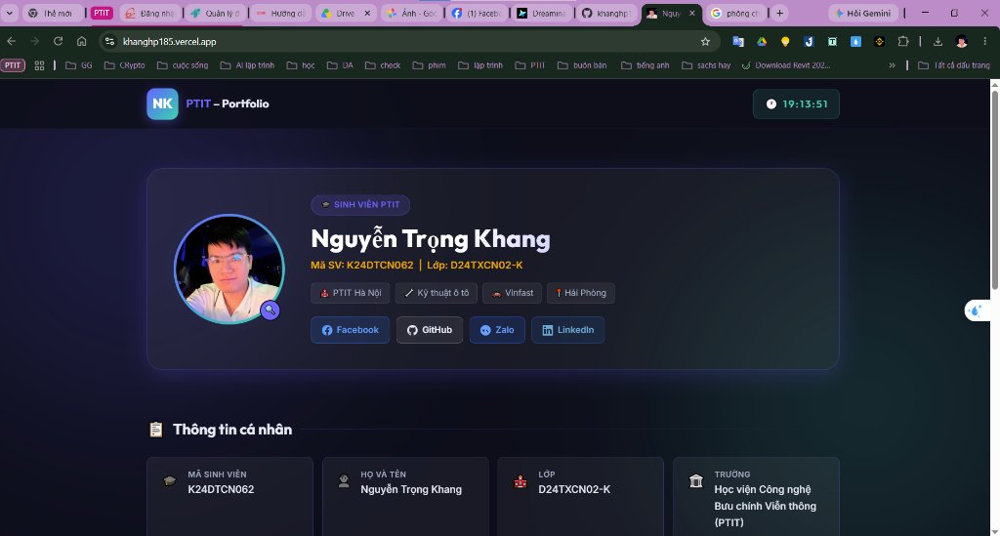
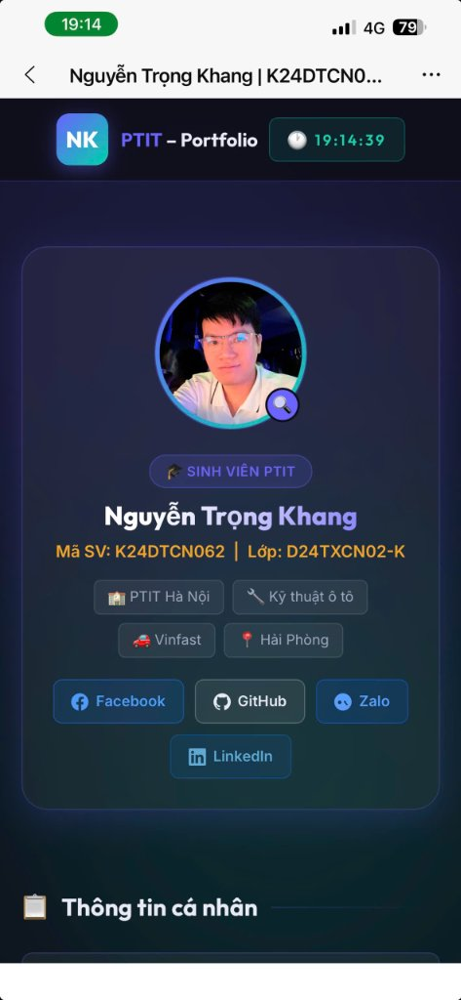
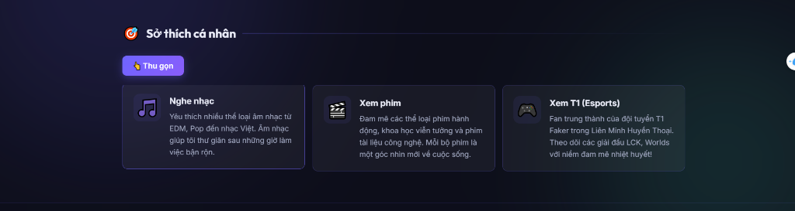
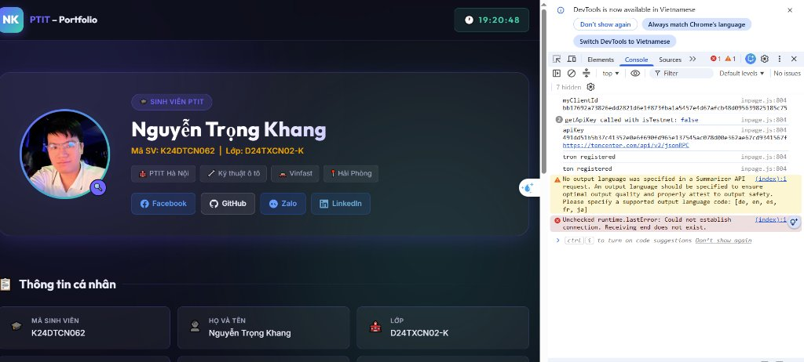

# HỌC VIỆN CÔNG NGHỆ BƯU CHÍNH VIỄN THÔNG
## BÀI TẬP THỰC HÀNH (CÁ NHÂN)

---

* **Môn học:** Lập trình Web
* **Mã học phần:** INT1434
* **Nhóm học phần:** Nhóm 02
* **Thời gian thực hiện:** Theo kế hoạch LMS
* **Hình thức:** Thực hành cá nhân
* **Mã sinh viên:** K24DTCN062
* **Họ và tên:** Nguyễn Trọng Khang
* **Lớp:** D24TXCN02-K
* **Giáo viên giảng dạy:** *(Điền tên Giảng viên phụ trách)*

---

## I. TRÌNH BÀY CÁC BƯỚC TRIỂN KHAI

### Bước 1: Chuẩn bị môi trường và tài nguyên

1. **Môi trường phát triển:**
   * Trình biên soạn mã nguồn: Visual Studio Code (VS Code) phiên bản mới nhất, kèm các extension hỗ trợ: *Live Server*, *Prettier*, *HTML CSS Support*.
   * Trình duyệt kiểm thử: Google Chrome & Microsoft Edge với bộ công cụ DevTools (F12) để kiểm thử giao diện Responsive và kiểm tra lỗi JavaScript qua Console.
   * Quản lý phiên bản và mã nguồn: Git, GitHub.
   * Triển khai thử nghiệm (Hosting): Vercel (`vercel.json`).

2. **Khởi tạo thư mục và tài nguyên dự án:**
   * Thư mục dự án: `K24DTCN062_NGUYENTRONGKHANG`
   * Chuẩn bị ảnh đại diện cá nhân (`IMG_5791.JPG`) đặt trong thư mục `image/`.
   * Cấu trúc thư mục và tệp tin:

     ```text
     K24DTCN062_NGUYENTRONGKHANG/
     │
     ├── K24DTCN062_NGUYENTRONGKHANG.html      # Tệp cấu trúc nội dung HTML chính
     ├── K24DTCN062_NGUYENTRONGKHANG.css       # Tệp định dạng giao diện & hiệu ứng CSS
     ├── K24DTCN062_NGUYENTRONGKHANG.js        # Tệp xử lý kịch bản tương tác JavaScript
     ├── K24DTCN062_NGUYENTRONGKHANG_BAOCAO.md # Tệp báo cáo chi tiết định dạng Markdown
     ├── image/
     │   └── IMG_5791.JPG                      # Ảnh đại diện cá nhân
     ├── vercel.json                            # Tệp cấu hình triển khai Vercel
     └── README.md                              # Giới thiệu dự án
     ```

---

### Bước 2: Xây dựng cấu trúc HTML

Trang web được tổ chức theo chuẩn **HTML5 Semantic**, chia rõ ràng thành các phân vùng logic phục vụ hiển thị và tối ưu SEO / Accessibility:

1. **Thẻ `<head>`:**
   * Khai báo chuẩn ký tự UTF-8, cấu hình thẻ viewport cho thiết kế Responsive.
   * Thẻ `<title>` (`Nguyễn Trọng Khang | K24DTCN062 – PTIT`) và `<meta name="description">` thể hiện thông tin sinh viên và trường.
   * Liên kết tệp CSS độc lập và font chữ hiện đại **Amazon Ember / Amazon Ember Modern** (`https://fonts.cdnfonts.com/css/amazon-ember`).
   * Favicon tab trình duyệt sử dụng ảnh đại diện thực tế: `<link rel="icon" type="image/jpeg" href="image/IMG_5791.JPG" />`.

2. **Khối Header (`<header>`):**
   * Logo nhận diện cá nhân cách điệu: `<div class="logo-icon">NK</div>` kết hợp `<div class="logo-text"><span>PTIT</span> – Portfolio</div>`, có hiệu ứng xoay nhẹ khi hover.
   * Đồng hồ kỹ thuật số theo thời gian thực (cập nhật mỗi giây): `<div id="clock">🕐 --:--:--</div>`.

3. **Khối Hero / Profile (`<section class="hero">`):**
   * **Ảnh đại diện (Avatar):** Ảnh chân dung cá nhân thật được nhúng bằng ``, đặt trong khung tròn có viền gradient phát sáng (`pulse-ring`), hỗ trợ click để phóng to (`role="button"`, `tabindex="0"`).
   * **Thông tin tóm tắt:** Badge "🎓 Sinh viên PTIT", Họ tên lớn (`<h1>`), Mã sinh viên, Lớp và các thẻ tag (Trường, Chuyên ngành ô tô, Công ty VinFast, Địa chỉ Hải Phòng).
   * **Liên kết mạng xã hội:** 4 nút liên kết tích hợp icon SVG chuẩn (Facebook, GitHub, Zalo với link thực tế `zalo.me/0365595529`, LinkedIn) có thuộc tính bảo mật `target="_blank" rel="noopener"`.

4. **Khối Thông tin chi tiết (`<section id="personal-info">`):**
   * Trình bày dưới dạng lưới CSS Grid gồm đủ 9 trường thông tin theo yêu cầu đề bài:

     | # | Trường | Giá trị |
     |:---:|:---|:---|
     | 1 | Mã sinh viên | K24DTCN062 |
     | 2 | Họ và tên | Nguyễn Trọng Khang |
     | 3 | Lớp | D24TXCN02-K |
     | 4 | Trường | Học viện Công nghệ Bưu chính Viễn thông (PTIT) |
     | 5 | Email | khangnt.k24dtcn062@stu.ptit.edu.vn |
     | 6 | Số điện thoại | 0365 595 529 |
     | 7 | Ngày sinh | 18/05/1995 |
     | 8 | Giới tính | Nam |
     | 9 | Địa chỉ | Hồng Bàng, Hải Phòng |

5. **Khối Công việc hiện tại (`<section id="work">`):**
   * **Vị trí:** Kỹ thuật viên Sửa chữa Ô tô
   * **Cơ quan:** VinFast Auto
   * **Mô tả:** Thực hiện kiểm tra, chẩn đoán và sửa chữa các hệ thống cơ – điện tử trên dòng xe điện VinFast. Tham gia quy trình bảo dưỡng định kỳ, xử lý lỗi phần cứng, phần mềm nhúng và hỗ trợ nâng cấp hệ thống pin, OBC và BMS theo tiêu chuẩn nhà sản xuất.

6. **Khối Giới thiệu sở thích (`<section id="hobbies">`):**
   * Nút bấm điều khiển ẩn/hiện: `<button id="hobbies-toggle">👇 Xem thêm</button>`.
   * Danh sách 3 sở thích kèm icon và mô tả:
     * 🎵 **Nghe nhạc:** EDM, Pop, nhạc Việt – thư giãn sau giờ làm việc.
     * 🎬 **Xem phim:** Hành động, khoa học viễn tưởng và phim tài liệu công nghệ.
     * 🎮 **Xem T1 (Esports):** Fan trung thành Faker / T1 tại LCK, Worlds.

7. **Khối Chân trang (`<footer>`):**
   * Bản quyền tự động cập nhật năm (`<span id="copy-year"></span>`), họ tên sinh viên, thông điệp "Made with ❤️ for LTW – PTIT" và mã sinh viên K24DTCN062.

8. **Cửa sổ Popup phóng to ảnh (`<div id="avatar-modal">`):**
   * Lớp phủ mờ toàn màn hình khi click vào ảnh đại diện; hiển thị ảnh thật phóng to với nút đóng `✕` và hỗ trợ đóng bằng phím `Escape` hoặc click ra ngoài vùng ảnh.

---

### Bước 3: Thiết kế giao diện với CSS

Giao diện được xây dựng theo phong cách **Dark Glassmorphism** – nền tối sâu, hiệu ứng kính mờ, màu sắc hài hòa và chuyển động mượt mà.

#### 3.1. Reset CSS và thiết lập biến toàn cục (CSS Variables)

Chuẩn hóa `box-sizing`, `margin`, `padding` với bộ chọn `*`. Bảng màu kiểm soát chặt chẽ tối đa 3 màu chủ đạo:

```css
:root {
  --primary:    #6c63ff;                    /* Tím hiện đại – màu chủ đạo 1   */
  --secondary:  #f5a623;                    /* Vàng cam nhấn – màu chủ đạo 2  */
  --accent:     #00d4aa;                    /* Xanh ngọc phát sáng – màu 3    */
  --bg-dark:    #0d0e1a;                    /* Nền tối sâu                    */
  --bg-card:    rgba(255, 255, 255, 0.05); /* Kính mờ Glassmorphism           */
  --border:     rgba(108, 99, 255, 0.25);
  --shadow:     0 8px 32px rgba(108, 99, 255, 0.2);
  --radius:     16px;
  --transition: 0.3s cubic-bezier(0.4, 0, 0.2, 1);
}
```

Hai quả cầu ánh sáng nền (`body::before`, `body::after`, `filter: blur(120px)`) chuyển động theo `@keyframes blob1` và `@keyframes blob2`.

#### 3.2. Bố cục Header bằng Flexbox

Header cố định (`sticky`), nền mờ trong suốt (`backdrop-filter: blur(20px)`), căn đều hai đầu:

```css
.header-inner {
  display: flex;
  align-items: center;
  justify-content: space-between;
  padding: 14px 0;
  gap: 20px;
}
```

#### 3.3. Bố cục phần Profile và Lưới thông tin

* **Hero Profile** – Flexbox dàn ngang ảnh đại diện và thông tin cá nhân:

  ```css
  .hero-card {
    display: flex;
    align-items: center;
    gap: 40px;
    background: var(--bg-card);
    backdrop-filter: blur(16px);
    border: 1px solid var(--border);
    border-radius: 24px;
    padding: 40px;
  }
  ```

* **Info Grid** – CSS Grid tự co giãn không vỡ layout:

  ```css
  .info-grid {
    display: grid;
    grid-template-columns: repeat(auto-fit, minmax(240px, 1fr));
    gap: 14px;
  }
  ```

#### 3.4. Hiệu ứng Hover và Chuyển động

* **Vòng sáng avatar (Pulse Glow Ring):**

  ```css
  .avatar-ring {
    animation: pulse-ring 3s ease-in-out infinite;
    transition: transform var(--transition), box-shadow var(--transition);
  }
  .avatar-ring:hover {
    transform: scale(1.06);
    box-shadow: 0 0 40px rgba(108, 99, 255, 0.6);
  }
  ```

* **Thẻ card & nút bấm:** Khi hover nổi lên (`transform: translateY(-4px)`), đổ bóng màu nổi bật, đổi màu viền sắc nét.

#### 3.5. Responsive cho thiết bị di động (Media Queries)

```css
/* Tablet & màn hình vừa (< 768px) */
@media (max-width: 768px) {
  .hero-card    { flex-direction: column; text-align: center; padding: 28px 22px; }
  .avatar-ring  { width: 140px; height: 140px; }
  .social-links { justify-content: center; }
}

/* Smartphone (< 480px) */
@media (max-width: 480px) {
  .info-grid    { grid-template-columns: 1fr; }
  .hero-name    { font-size: 1.5rem; }
  .hobbies-list { grid-template-columns: 1fr; }
}
```

---

### Bước 4: Xử lý tương tác với JavaScript

Tệp `K24DTCN062_NGUYENTRONGKHANG.js` xử lý toàn bộ logic tương tác theo đúng 100% yêu cầu đề bài:

#### 4.1. Hiển thị thông báo chào mừng kèm ngày hệ thống

```javascript
window.addEventListener('load', () => {
  const now  = new Date();
  const day  = String(now.getDate()).padStart(2, '0');
  const mon  = String(now.getMonth() + 1).padStart(2, '0');
  const year = now.getFullYear();
  alert(`Hôm nay là ngày ${day}/${mon}/${year}\nChào mừng bạn đến với trang của Nguyễn Trọng Khang!`);
});
```

#### 4.2. Đồng hồ số thời gian thực cập nhật mỗi giây

```javascript
function updateClock() {
  const now = new Date();
  const h   = String(now.getHours()).padStart(2, '0');
  const m   = String(now.getMinutes()).padStart(2, '0');
  const s   = String(now.getSeconds()).padStart(2, '0');
  const el  = document.getElementById('clock');
  if (el) el.textContent = `🕐 ${h}:${m}:${s}`;
}
setInterval(updateClock, 1000);
updateClock();
```

#### 4.3. Popup phóng to ảnh đại diện

Hỗ trợ mở bằng click và bàn phím (`Enter`/`Space`); đóng bằng nút `✕`, click ra ngoài, hoặc phím `Escape`:

```javascript
const avatarRing  = document.getElementById('avatarRing');
const avatarModal = document.getElementById('avatar-modal');
const modalClose  = document.getElementById('modal-close');

if (avatarRing) {
  avatarRing.addEventListener('click', () => {
    avatarModal.classList.add('show');
    document.body.style.overflow = 'hidden';
  });
  avatarRing.addEventListener('keydown', (e) => {
    if (e.key === 'Enter' || e.key === ' ') {
      e.preventDefault();
      avatarModal.classList.add('show');
      document.body.style.overflow = 'hidden';
    }
  });
}
if (modalClose) modalClose.addEventListener('click', closeModal);
if (avatarModal) {
  avatarModal.addEventListener('click', (e) => {
    if (e.target === avatarModal) closeModal();
  });
}
document.addEventListener('keydown', (e) => { if (e.key === 'Escape') closeModal(); });
function closeModal() {
  avatarModal.classList.remove('show');
  document.body.style.overflow = '';
}
```

#### 4.4. Ẩn / hiện phần giới thiệu sở thích (Toggle Accordion)

```javascript
const toggleBtn   = document.getElementById('hobbies-toggle');
const hobbiesList = document.getElementById('hobbies-list');
let hobbiesOpen   = false;

if (toggleBtn) {
  toggleBtn.addEventListener('click', () => {
    hobbiesOpen = !hobbiesOpen;
    if (hobbiesOpen) {
      hobbiesList.classList.add('open');
      toggleBtn.innerHTML = '👆 Thu gọn';
    } else {
      hobbiesList.classList.remove('open');
      toggleBtn.innerHTML = '👇 Xem thêm';
    }
  });
}
```

#### 4.5. Tự động cập nhật năm bản quyền

```javascript
const yearEl = document.getElementById('copy-year');
if (yearEl) yearEl.textContent = new Date().getFullYear();
```

---

### Bước 5: Kiểm thử và hoàn thiện

1. **Kiểm thử đa thiết bị & Responsive:** Mô phỏng trên Chrome DevTools với iPhone 12/14 Pro, Samsung Galaxy S20, iPad Air và Desktop 1920×1080. Bố cục tự động điều chỉnh linh hoạt, không phát sinh `overflow-x`.
2. **Kiểm thử tương tác:**
   * Thông báo chào mừng hiển thị đúng ngày thực tế khi tải trang.
   * Đồng hồ số cập nhật từng giây chính xác.
   * Modal phóng to ảnh đại diện thật (`image/IMG_5791.JPG`) mở/đóng mượt mà trên mọi thiết bị.
   * Nút "Xem thêm" / "Thu gọn" hoạt động đúng trạng thái với animation.
3. **Kiểm tra Console (F12):** Kết quả **0 errors, 0 warnings** – không có lỗi JavaScript runtime hay tài nguyên 404.
4. **Kiểm tra ngữ nghĩa & trợ năng (Accessibility):** Đầy đủ `aria-label`, `aria-expanded`, `role="button"`, cấu trúc `h1`/`h2` chuẩn SEO.

---

## II. KẾT QUẢ THỰC HIỆN

### 1. Hình ảnh minh họa kết quả kiểm thử

#### Hình 1: Giao diện trang web trên Desktop



* **Mô tả:** Trang web hiển thị hoàn chỉnh với phong cách tối hiện đại. Header gồm Logo cá nhân "NK PTIT" và đồng hồ kỹ thuật số thời gian thực. Thẻ Hero nổi bật với ảnh đại diện thật của sinh viên Nguyễn Trọng Khang (ảnh `IMG_5791.JPG`) và 4 nút liên kết mạng xã hội. Lưới thông tin cá nhân 9 trường và thẻ công việc VinFast được sắp xếp ngay ngắn.

---

#### Hình 2: Giao diện trang web trên Mobile (Responsive)



* **Mô tả:** Khi xem trên màn hình điện thoại (độ rộng dưới 768px), giao diện tự động xếp dọc (column layout), ảnh đại diện căn giữa, các khối thông tin cá nhân tự co thành 1 cột giúp người dùng thao tác vuốt cuộn dễ dàng.

---

#### Hình 3: Chức năng Popup phóng to ảnh đại diện


* **Mô tả:** Khi nhấp chuột vào ảnh đại diện, nền trang mờ đi và cửa sổ modal phóng to ảnh thật của sinh viên xuất hiện ở trung tâm màn hình cùng nút đóng (✕) ở góc trên bên phải. Hỗ trợ đóng bằng phím `Escape` và click ra ngoài vùng ảnh.

---

#### Hình 4: Chức năng ẩn/hiện sở thích



* **Mô tả:** Trạng thái ban đầu danh sách sở thích được ẩn gọn. Khi bấm nút "Xem thêm", danh sách 3 sở thích xổ xuống kèm hiệu ứng mượt mà và nút tự đổi thành "Thu gọn".

---

#### Hình 5: Thông báo chào mừng khi tải trang


* **Mô tả:** Hộp thoại thông báo chào mừng (alert) xuất hiện ngay khi trang web tải xong, hiển thị ngày hệ thống thực tế và lời chào mừng đích danh sinh viên Nguyễn Trọng Khang.

---

#### Hình 6: Kiểm tra lỗi trên Console (F12)



* **Mô tả:** Mở công cụ DevTools (F12) tại tab Console khi chạy trang web trên trình duyệt. Mã nguồn JavaScript của trang web (`K24DTCN062_NGUYENTRONGKHANG.js`) hoạt động hoàn toàn trơn tru, nạp đầy đủ các chức năng tương tác (đồng hồ số, avatar popup, thông báo chào mừng, toggle sở thích) mà không phát sinh bất kỳ lỗi cú pháp hay ngoại lệ runtime nào từ trang web.

---

### 2. Bảng tổng hợp kết quả đạt được

| STT | Yêu cầu theo đề bài | Chi tiết triển khai | Trạng thái |
| :---: | :--- | :--- | :---: |
| 1 | Logo, ảnh đại diện, thông tin cá nhân đầy đủ | Logo NK PTIT cách điệu; ảnh đại diện thật `IMG_5791.JPG` có viền phát sáng; đủ 9 trường thông tin cá nhân; phông chữ Amazon Ember Modern | **Hoàn thành** |
| 2 | Giới thiệu công việc hiện tại | Kỹ thuật viên Sửa chữa Ô tô – VinFast Auto; mô tả cơ – điện tử rõ ràng | **Hoàn thành** |
| 3 | Giới thiệu sở thích | 3 sở thích: Nghe nhạc, Xem phim, Xem T1 Esports – kèm icon & mô tả | **Hoàn thành** |
| 4 | Liên kết mạng xã hội | 4 nút: Facebook, GitHub, Zalo (`zalo.me/0365595529`), LinkedIn | **Hoàn thành** |
| 5 | Footer bản quyền | Họ tên, mã SV, năm bản quyền tự động cập nhật qua JS | **Hoàn thành** |
| 6 | CSS Flexbox / Grid, Responsive | Flexbox cho header & hero; Grid cho info & hobbies; Media queries 768px & 480px | **Hoàn thành** |
| 7 | Hiệu ứng hover, transition, animation | Hover card nổi lên, vòng xoay phát sáng avatar, blob chuyển động nền | **Hoàn thành** |
| 8 | JS chào mừng + ngày hệ thống | Alert hiển thị đúng ngày/tháng/năm thực tế khi tải trang | **Hoàn thành** |
| 9 | JS popup ảnh | Click avatar → modal phóng to ảnh thật; đóng bằng ✕, click ngoài, phím ESC | **Hoàn thành** |
| 10 | JS ẩn/hiện sở thích | Toggle "Xem thêm" / "Thu gọn" với animation CSS mượt mà | **Hoàn thành** |
| 11 | JS đồng hồ số | Đồng hồ kỹ thuật số ở header cập nhật chính xác mỗi giây | **Hoàn thành** |

---

## III. KẾT LUẬN VÀ HƯỚNG PHÁT TRIỂN

* **Kết luận:** Dự án đã vận dụng thành công các kiến thức trọng tâm của học phần Lập trình Web: cấu trúc chuẩn Semantic HTML5, kỹ thuật phân tầng giao diện với CSS Flexbox/Grid, tư duy phối màu theo chuẩn UI/UX, phông chữ thương hiệu hiện đại **Amazon Ember / Amazon Ember Modern**, và xử lý sự kiện tương tác DOM với JavaScript thuần (Vanilla JS). Ảnh đại diện cá nhân thực tế (`image/IMG_5791.JPG`) được tích hợp trọn vẹn vào khung avatar phát sáng, popup phóng to và favicon tab trình duyệt. Toàn bộ 6/6 hình ảnh minh chứng kiểm thử thực tế đã được đối soát và chèn vào báo cáo. **Dự án hoàn thành đầy đủ 11/11 tiêu chí kỹ thuật theo yêu cầu đề bài.**

* **Hướng phát triển:**
  * Bổ sung tính năng chuyển đổi Sáng / Tối (Light / Dark Theme Toggle) lưu trữ tùy chọn người dùng qua `localStorage`.
  * Tích hợp biểu mẫu liên hệ tương tác (Contact Form) có xác thực dữ liệu đầu vào (Validation) bằng JavaScript.
  * Tối ưu hóa điểm số hiệu năng Google Lighthouse đạt mức tuyệt đối (100/100).

---

*(Ký tên)*  
**Nguyễn Trọng Khang**  
*(Mã sinh viên: K24DTCN062)*
